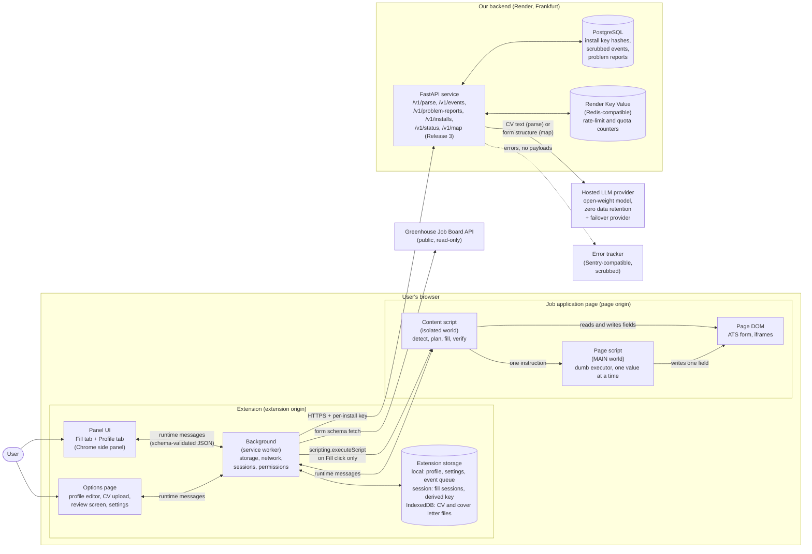
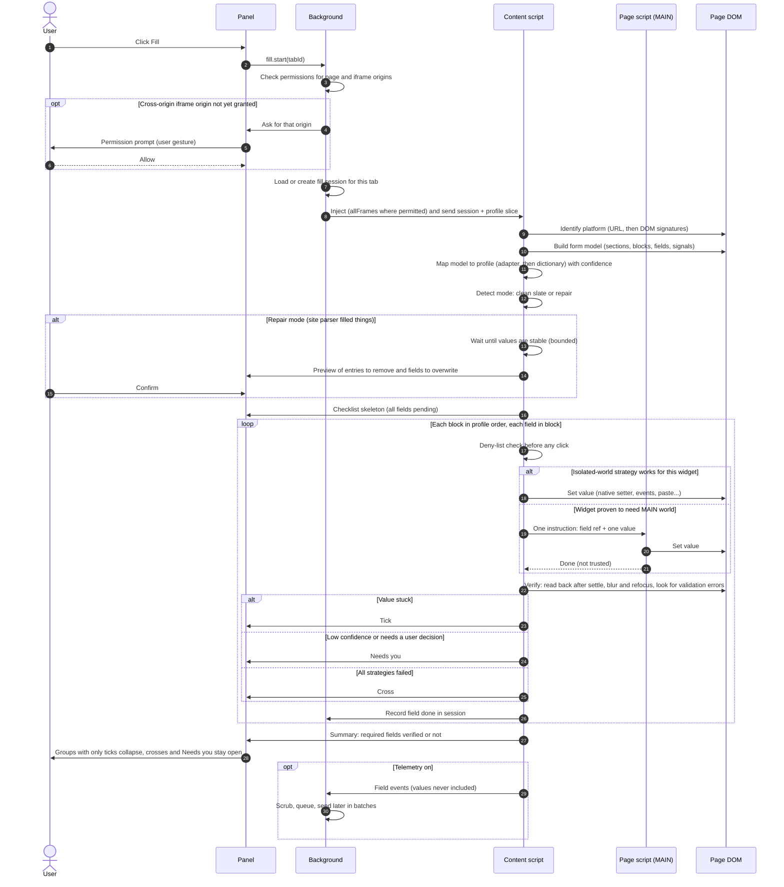
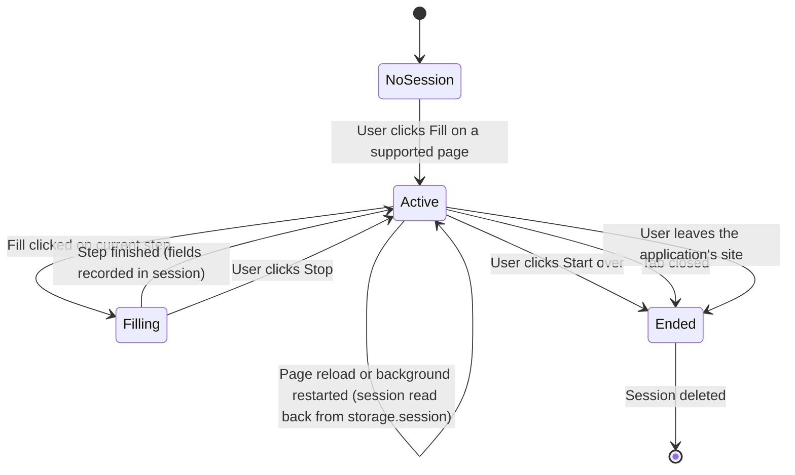
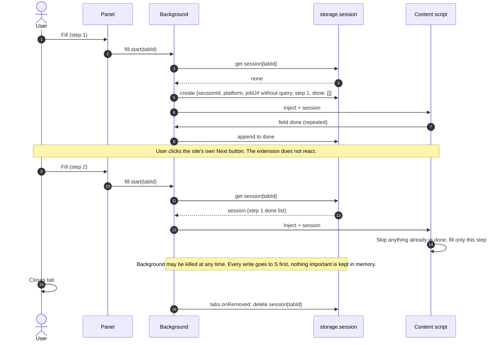
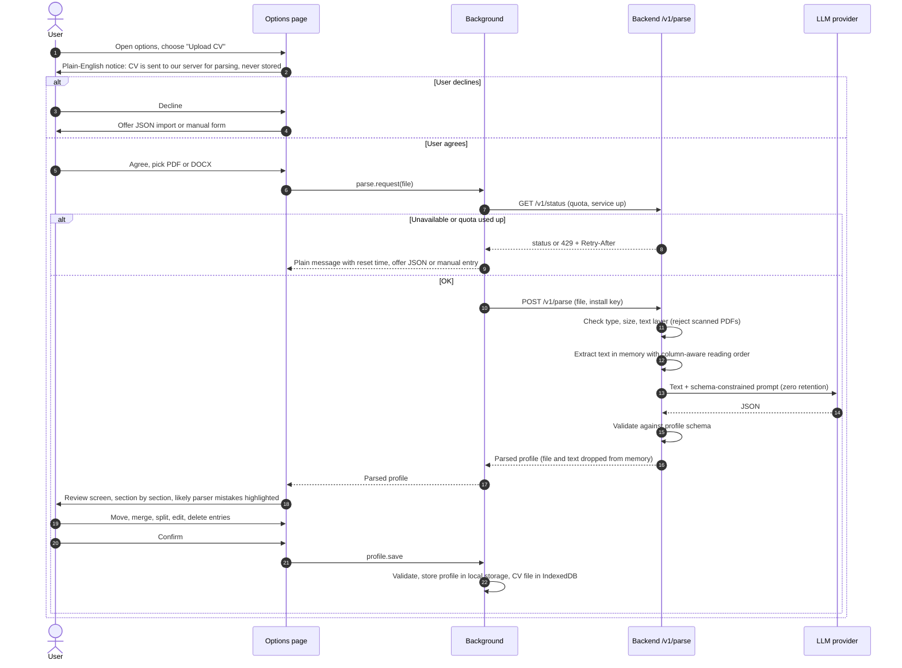
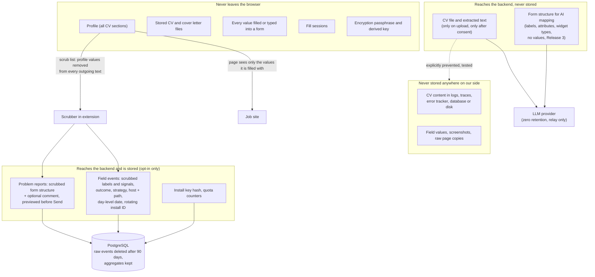

# Architecture

Status: draft for review. Source of truth for requirements is [spec.md](spec.md). Each significant choice listed here gets an ADR in `docs/adr/` when its milestone starts.

Release 1 covers Chromium only. Diagrams show the full design, so Firefox and Safari can be added later without rework. Where a part is not built in Release 1, the text says so.

## 1. System overview

**What it shows.** The extension has four parts. The panel and options page are the user interface. The background owns everything that must survive: storage, network calls, fill sessions and permissions. The content script is injected into the job page only when the user clicks Fill, and does all detection, filling and checking. The page script runs inside the page's own JavaScript context and is used only for the few widgets that ignore the content script; it gets one value at a time and is never trusted.

Every network call goes out from the background. The backend relays CV text (one-time parse) or form structure (AI mapping, Release 3) to a hosted LLM, stores only scrubbed telemetry and problem reports in PostgreSQL, and keeps rate-limit counters in Key Value. Filling itself never needs the backend: if the backend is down, the extension still fills with its built-in rules.

## 2. Fill flow (one step of one form)

**What it shows.** Nothing runs until the user clicks Fill. The background checks and, if needed, asks for permission, then injects the content script. The content script works out which platform it is on, builds a model of the form, and matches each field to a profile key with a confidence score. If the site's own CV parser has already filled things, the user sees a preview of what will be changed and must confirm. Each field is then filled using the safest strategy that works, and every field is checked by reading it back and blurring it, so a value that only looks filled is caught. The panel updates live: a tick for verified, a cross for failed, "Needs you" where the extension chose not to guess. Low-confidence fields are never filled. Telemetry, if the user turned it on, records only what happened, never what was typed.

Stop and pause on user typing (not drawn) cancel the loop between fields; the content script always finishes or rolls back the current field before stopping, so the page is never left half-written.

## 3. Multi-step flow (fill session lifecycle)

**What it shows.** A fill session belongs to one tab and one application. The background keeps it in `storage.session` (in memory, cleared when the browser closes), never in the page, because content scripts are thrown away on navigation. Each Fill click reads the session, fills only what is new on the current step, and writes progress back field by field, so a reload or a killed background loses nothing. The extension never presses Next and never reacts to step changes. The session ends when the tab closes, the user leaves the site, or the user clicks "Start over".

Release 1 note: Greenhouse and Lever are single-page forms. See plan.md, question Q12, on whether the multi-step session belongs in Release 1 or Release 2 (Workday).

## 4. CV setup flow

**What it shows.** Before a CV leaves the browser the user is told, in plain words, where it goes and that it is not stored, and must agree. Users who decline can import JSON or type their profile. The backend checks quota and the file, pulls the text out in memory (reading two-column layouts in the right order), asks the LLM for output that must match the profile schema, validates it, returns it, and keeps nothing. The review screen is mandatory: nothing is saved until the user confirms, and the entries most likely to be wrong (a project filed as a job, a description under the wrong entry, a missing company or title) are shown first. Parsing only happens again if the user uploads a new CV.

## 5. Data flow and privacy

**What it shows.** The profile, stored files, filled values, fill sessions and the encryption key never leave the user's browser. The only things that can reach our backend are:

- The CV itself, once, at upload time, after consent. It is held in memory for that one request and passed to the LLM provider under a zero-retention setting. It is never written to disk, the database, logs or the error tracker, and a test proves request bodies for this endpoint never reach logs.
- Form structure (labels and field types, never values) for the AI mapper, from Release 3.
- If the user opts in: per-field events and problem reports. Both are scrubbed in the browser first, removing every substring that matches a profile value plus anything that looks like an email, phone number, URL or name. The backend scrubs again as a second line of defence. The install ID rotates every 30 days and dates are rounded to the day, so events cannot easily be joined into a list of applications.

The job site itself sees only the values the extension writes into its form, which is what the user wanted to send it anyway.
